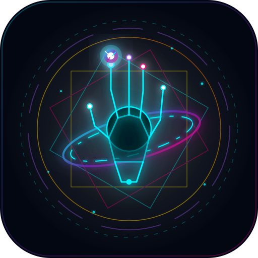
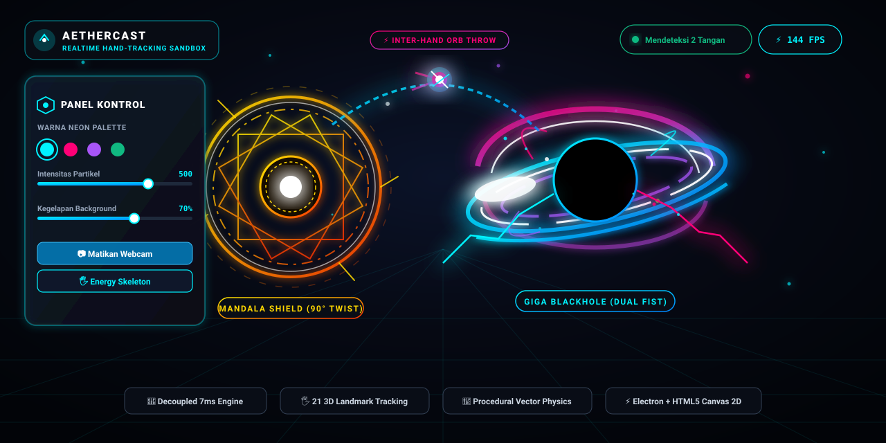

<p align="center">
  
</p>

<h1 align="center">AETHERCAST</h1>

<p align="center">
  <strong>Realtime Hand-Tracking Sandbox & Particle Physics Engine</strong><br>
  Interactive gesture-driven visual spellcasting powered by MediaPipe Hands, HTML5 Canvas 2D, and Electron.
</p>

<p align="center">
  
  
  
  
</p>

---

## 🌟 Visual Preview

<p align="center">
  
</p>

AetherCast transforms ordinary webcam video into a responsive visual sandbox. By decoupling hand tracking from canvas rendering, the engine tracks 21 distinct 3D hand joints and renders complex particle systems, procedural black holes, and mandala shields at up to 144+ FPS without frame drops.

---

## 🖐️ Gesture System & Visual Effects

| Gestur Tangan | Nama Efek Visual | Mekanisme & Parameter Trigger |
|---|---|---|
| **Mengepal (Fist)** | **Gargantua Blackhole** | Event horizon hitam pekat (`#000000`) dengan piringan akresi berputar. Waktu pengisian energi 3.8 detik; butuh minimal 50% charge untuk memicu ledakan Supernova saat kepalan dibuka. Delay pendinginan 3.0 detik. |
| **Telapak Terbuka + Putaran Pergelangan 90°** | **Doctor Strange Mandala Shield** | Formasi mandala ganda berputar dengan aksara kuno dan percikan bunga api. Membutuhkan putaran pergelangan tangan minimal 90° untuk mencegah trigger tidak sengaja saat tangan diam. |
| **Cubit Ujung Jempol & Telunjuk (Pinch)** | **Floating Cosmic Energy Orb** | Bola plasma kosmik menyala di atas ujung jari telunjuk. Mengorbit secara konsisten mengikuti pergerakan tangan kiri maupun kanan. |
| **Kibaskan Tangan / Cubit Tangan Penerima** | **Inter-Hand Orb Throw & Transfer** | Melempar bola kosmik melintasi layar sebagai proyektil komet dengan lintasan parabolik, ekor partikel debu bintang, dan sistem homing dinamis ke ujung telunjuk tangan lawan. |
| **Dua Tangan Mengepal Rapat** | **Supermassive Giga Blackhole** | Simulasi vektor prosedural: lengkungan lensa gravitasi Einstein atas-bawah, 3 cincin pusaran akresi diferensial berlawanan arah, loop korona surya plasma, dan sambaran petir tegangan tinggi antar kepalan tangan. |
| **Dua Telapak Terbuka Rapat** | **Multiverse Giga Shield Array** | Menggabungkan perisai kedua tangan menjadi formasi barikade mandala konsentris raksasa. |

---

## ⚙️ Arsitektur & Optimasi Performa

AetherCast dirancang agar tetap ringan dan responsif pada komputer dengan webcam standar:

1. **Decoupled Offscreen Tracking (480x270)**:
   Proses inferensi AI MediaPipe dijalankan pada canvas offscreen beresolusi rendah (480x270). Beban inferensi WASM berkurang menjadi hanya ~7ms per frame, sehingga thread utama rendering tetap bebas menjalankan animasi pada 60–144+ FPS.
2. **Batched Particle Draw Calls**:
   500+ partikel dan percikan cahaya digabungkan ke dalam 4–5 batch path GPU, bukan ratusan pemanggilan `beginPath()` / `stroke()` individual.
3. **Delta-Time Physics Normalization**:
   Kecepatan rotasi cincin akresi, gravitasi partikel, dan proyektil dinormalisasi berbasis delta waktu (`dt / 16.67ms`), menghasilkan tempo animasi identik di monitor 60Hz, 120Hz, maupun 144Hz.
4. **Single-Authority Orb State Machine**:
   Mekanisme transfer bola antar tangan diatur oleh satu status sentral (`activeCosmicHandId`) untuk mencegah bug duplikasi bola kosmik saat transisi cepat kedua tangan.
5. **100% Procedural Vector Rendering**:
   Efek Giga Blackhole dibuat murni menggunakan matematika geometri Canvas 2D (busur elips, gradien radial, dan garis putus-putus diferensial), menghilangkan glitch distorsi kotak dan kliping tekstur raster.

---

## 🎛️ Panel Kontrol & Kustomisasi

Aplikasi menyediakan overlay kontrol transparan bergaya glassmorphism:

- **Neon Color Palettes**: Pilihan 5 palet warna neon (`Cyber Cyan`, `Solar Gold`, `Arcane Purple`, `Emerald Spark`, `Prismatic Rainbow`). Palet akan diacak otomatis setiap aplikasi dibuka.
- **Particle Intensity Slider**: Mengatur jumlah partikel aktif dari 100 hingga 1500 partikel simultan.
- **Webcam Darkness Slider**: Mengatur tingkat kegelapan latar webcam (0% transparan hingga 100% hitam pekat) untuk menonjolkan visual partikel.
- **Glow & Spark Size**: Menyesuaikan radius bloom dan ukuran percikan cahaya.
- **Energy Skeleton Toggle**: Menampilkan garis tulang dan sendi tangan bersinar neon.
- **Webcam Off Mode**: Mematikan kamera webcam dan beralih ke latar angkasa gelap.
- **Mouse / Touch Fallback**: Memungkinkan kontrol gravitasi partikel dan efek menggunakan kursor mouse atau layar sentuh ketika kamera tidak aktif.

---

## 🚀 Panduan Instalasi & Penggunaan

### Prasyarat
- [Node.js](https://nodejs.org/) (versi 16 atau lebih baru)
- Webcam fungsional

### Opsi 1: Menjalankan Aplikasi Desktop (Electron)
```bash
# 1. Clone repositori
git clone https://github.com/UnnamedPeople-Chin/AetherCast.git
cd AetherCast

# 2. Pasang dependensi
npm install

# 3. Jalankan aplikasi
npm start
```

### Opsi 2: Menjalankan via Browser (HTTP Server)
Karena MediaPipe membutuhkan konteks aman (secure context), jalankan file melalui server lokal:
```bash
# Menggunakan Python
python -m http.server 8080

# Atau menggunakan npx serve
npx serve .
```
Buka browser dan akses alamat `http://localhost:8080`.

---

## 📁 Struktur Direktori

```text
AetherCast/
├── Assets/
│   ├── logo.svg              # Logo vektor Cyberpunk AetherCast
│   ├── banner_preview.svg    # Visual showcase banner resolusi tinggi
│   └── shield_mandala.png    # Tekstur mandala perisai kuno
├── app.js                    # Core engine: tracking, physics, canvas rendering, gesture logic
├── index.html                # Struktur DOM, canvas overlay, dan panel kontrol UI
├── style.css                 # Styling glassmorphism, tipografi, dan tata letak responsif
├── main.js                   # Konfigurasi jendela Electron desktop
├── package.json              # Konfigurasi dependensi dan skrip Electron
└── README.md                 # Dokumentasi proyek
```

---

## 📄 Lisensi

Proyek ini dirilis di bawah lisensi [MIT](LICENSE). Dibuat dengan dedikasi oleh **UnnamedPeople-Chin**.
